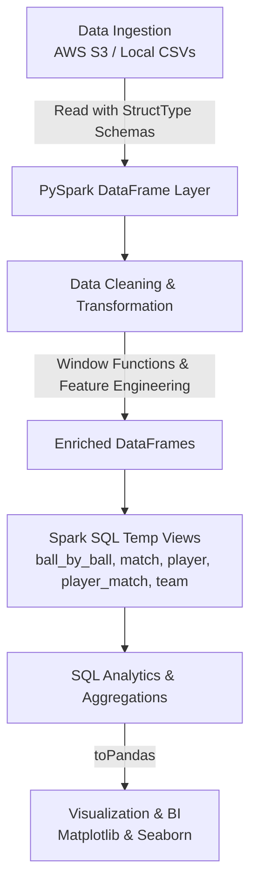

# 🏏 IPL Data Analysis using Apache Spark (PySpark)

An end-to-end Big Data analytics and engineering project that processes and analyzes historical Indian Premier League (IPL) cricket datasets using **Apache Spark (PySpark)**, **Spark SQL**, and Python visualization libraries (**Matplotlib**, **Seaborn**).

---

## 📋 Table of Contents
- [Overview](#overview)
- [System Architecture](#system-architecture)
- [Dataset Schemas](#dataset-schemas)
- [Key Features & Transformations](#key-features--transformations)
- [Analytical Insights & Queries](#analytical-insights--queries)
- [Visualizations](#visualizations)
- [Tech Stack](#tech-stack)
- [Project Structure](#project-structure)
- [Getting Started](#getting-started)
  - [Prerequisites](#prerequisites)
  - [Installation](#installation)
  - [Configuration & Execution](#configuration--execution)
- [Future Enhancements](#future-enhancements)
- [License](#license)

---

## 📌 Overview

The Indian Premier League (IPL) generates rich, multi-dimensional ball-by-ball and match-level cricket data. As dataset sizes grow across dozens of seasons, traditional in-memory data processing frameworks face scalability bottlenecks.

This project demonstrates how to harness **Apache Spark** to:
1. Enforce strict, production-grade schemas on semi-structured CSV data hosted on cloud storage (AWS S3) or local filesystems.
2. Cleanse, normalize, and transform relational cricket data using PySpark DataFrames and Window functions.
3. Perform complex analytical aggregations via Spark SQL temporary views.
4. Convert Spark aggregations into actionable visual insights with Pandas, Matplotlib, and Seaborn.

---

## 🏗️ System Architecture



---

## 🗄️ Dataset Schemas

The project models the cricket data into 5 core relational entities using PySpark `StructType`:

| Dataset | Schema Entity | Description |
| :--- | :--- | :--- |
| `Ball_By_Ball.csv` | `ball_by_ball_schema` | Delivery-level details: runs scored, extras, dismissal types, wicket flags, striker, non-striker, bowler IDs. |
| `Match.csv` | `match_schema` | Match-level metadata: teams, venue, city, match date, toss winner, toss decision, match winner, margin. |
| `Player.csv` | `player_schema` | Biographical data: player ID, player name, date of birth, batting hand, bowling skill, country. |
| `Player_match.csv` | `player_match_schema` | Match participation details: player roles, captaincy, wicket-keeping status, age on match day, Man of the Match awards. |
| `Team.csv` | `team_schema` | Team IDs and franchise names. |

---

## ⚙️ Key Features & Transformations

### 1. Delivery Filtering & Run Aggregation
- Filters out non-legal deliveries (`wides == 0` and `noballs == 0`) for true delivery-level batsman analysis.
- Computes total runs and average runs per match and inning using PySpark aggregations.

### 2. Window Functions for Cumulative Scoring
- Leverages `Window.partitionBy("match_id", "innings_no").orderBy("over_id")` to track the match progression and running score trajectory over by over.

### 3. Conditional Feature Engineering
- **High Impact Deliveries**: Identifies pivotal moments by flagging deliveries resulting in a bowler wicket or $> 6$ runs (including extras).
- **Date Decomposition**: Breaks match dates into `year`, `month`, and `day` components.
- **Win Margin Categorization**: Segmented into `High` ($\ge 100$ runs), `Medium` ($50 - 99$ runs), and `Low` ($< 50$ runs).
- **Toss vs Match Winner Correlation**: Computes a conditional binary flag (`Yes` / `No`) indicating whether winning the toss directly resulted in a match victory.
- **Player Age & Experience**: Flags veteran players (`age_as_on_match >= 35`) and computes career longevity (`years_since_debut`).
- **Data Normalization & Imputation**: Cleans string noise using regular expressions (`regexp_replace`), normalizes names to lowercase, and imputes missing batting/bowling attributes with default fallbacks.

---

## 🔍 Analytical Insights & Queries

Using Spark SQL views, the notebook evaluates key sports analytics questions:

1. **Top Scoring Batsmen per Season**: Identifies leading run-getters (Orange Cap contenders) across individual IPL editions.
2. **Most Economical Bowlers in Powerplay**: Identifies the tightest bowlers in overs 1–6 based on average runs conceded per delivery and total wickets taken.
3. **Toss Decision Impact**: Compares match outcomes (`Won` vs `Lost`) conditioned on toss results.
4. **Impact of Batsmen in Winning Matches**: Calculates the average contribution of batsmen in matches where their team emerged victorious.
5. **Venue Scoring Dynamics**: Evaluates average and peak scores across different stadiums to identify batting paradises vs bowling-friendly pitches.
6. **Dismissal Frequency Breakdown**: Quantifies the distribution of wickets by dismissal modes (Caught, Bowled, Run Out, LBW, Stumped, etc.).
7. **Franchise Win Performance After Winning Toss**: Assesses which teams capitalize most effectively on winning the toss.

---

## 📊 Visualizations

The analytical results are transformed via `.toPandas()` and visualized:
- 📈 **Top 10 Most Economical Powerplay Bowlers**: Bar plot highlighting bowler economy in overs 1–6.
- 🎯 **Impact of Winning Toss on Match Outcomes**: Seaborn count plot displaying toss win vs match win distributions.
- 🏏 **Average Runs in Wins (Top Scorers)**: Bar chart illustrating key match-winning contributions.
- 🏟️ **Distribution of Scores by Venue**: Horizontal bar chart comparing scoring patterns across grounds.
- 🧤 **Dismissal Type Frequency**: Distribution analysis of dismissals throughout tournament history.
- 🏆 **Team Performance After Winning Toss**: Franchise-wise performance and win counts after winning the toss.

---

## 🛠️ Tech Stack

- **Core Engine:** Apache Spark 3.x (PySpark)
- **Language:** Python 3.8+
- **Data Storage:** AWS S3 (`s3://...`) / Local CSV storage
- **Data Manipulation:** PySpark SQL, PySpark Window Functions, Pandas
- **Visualization:** Matplotlib, Seaborn
- **Environment:** Jupyter Notebook / Databricks / AWS EMR

---

## 📂 Project Structure

```text
ipl-data-analysis-apache-spark-project/
├── IPL_DATA_ANALYSIS_SPARK.ipynb   # Main Jupyter Notebook containing the full PySpark pipeline
└── README.md                       # Comprehensive project documentation
```

---

## 🚀 Getting Started

### Prerequisites

Ensure you have the following installed on your machine:
- **Java 8 or 11** (Required by Apache Spark)
- **Python 3.8+**
- **pip** package manager

### Installation

1. **Clone the repository:**
   ```bash
   git clone https://github.com/<your-username>/ipl-data-analysis-apache-spark-project.git
   cd ipl-data-analysis-apache-spark-project
   ```

2. **Create and activate a virtual environment (optional but recommended):**
   ```bash
   # Windows
   python -m venv venv
   .\venv\Scripts\activate

   # Linux / macOS
   python3 -m venv venv
   source venv/bin/activate
   ```

3. **Install required dependencies:**
   ```bash
   pip install pyspark pandas matplotlib seaborn jupyter
   ```

### Configuration & Execution

1. **Configure Data Source:**
   By default, the notebook loads datasets from an AWS S3 bucket:
   ```python
   ball_by_ball_df = spark.read.schema(ball_by_ball_schema).format("csv").option("header", "true").load("s3://ipl-data-analysis-project/Ball_By_Ball.csv")
   ```
   If running locally or with local CSV files, place your datasets in a `data/` directory and update the path:
   ```python
   ball_by_ball_df = spark.read.schema(ball_by_ball_schema).format("csv").option("header", "true").load("data/Ball_By_Ball.csv")
   ```

2. **Launch Jupyter Notebook:**
   ```bash
   jupyter notebook IPL_DATA_ANALYSIS_SPARK.ipynb
   ```

3. **Run the Notebook:**
   Execute the cells sequentially to initialize the Spark session, build DataFrames, register temp views, execute SQL queries, and generate the plots.

---

## 🔮 Future Enhancements

- [ ] **Spark MLlib Integration**: Predict match outcomes or first-innings total scores using machine learning regression/classification models.
- [ ] **Automated Orchestration**: Integrate with Apache Airflow to schedule and automate recurring ETL runs.
- [ ] **Interactive Dashboard**: Build a Streamlit or Dash web application for live interactive slicing and filtering of IPL player and team metrics.
- [ ] **Delta Lake / Parquet Conversion**: Convert raw CSV datasets into partitioned Delta Lake or Apache Parquet formats for faster columnar queries and ACID transactions.

---

## 📄 License

This project is licensed under the [MIT License](LICENSE) — feel free to use, modify, and distribute for educational and analytical purposes.
